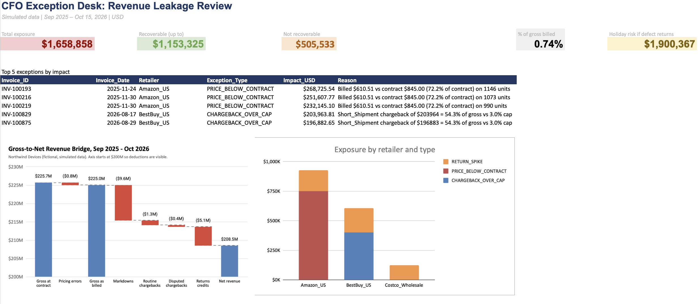
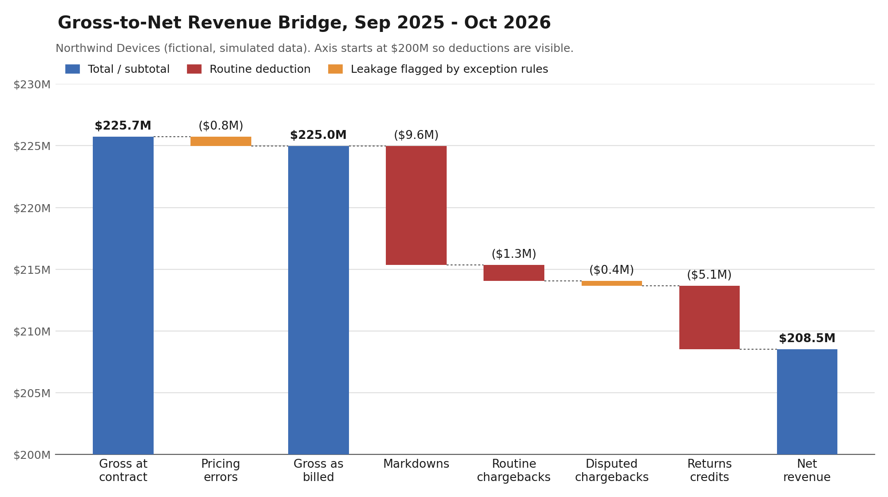

# LedgerGuard: Revenue Leakage Analysis for a Consumer Electronics Distributor

An FP&A-style analysis that finds where revenue leaks between **gross invoiced sales** and **net revenue** for Northwind Devices, a fictional PC hardware vendor selling through big-box retailers (Best Buy, Amazon, Costco).

> **All data is simulated.** Northwind Devices is a fictional company; any resemblance to real vendors, products or contract terms is coincidental.



## The business problem

Hardware vendors invoice retailers at contract prices, then lose revenue through markdown allowances, chargebacks (deductions) and returns. Most of that is normal cost of doing business. Some of it is error or invalid claims that FP&A and the deductions team need to catch, dispute or reserve for. LedgerGuard checks every invoice against its contract terms and sizes the leakage in dollars.

## Key findings

**$1.66M of revenue leakage found across 1,000 invoices (0.74% of gross billed). Up to $1.15M may be recoverable.**

| Issue | Retailer | When | Impact | Recoverable? | Action |
|---|---|---|---|---|---|
| 15% discount applied twice | Amazon | Black Friday week 2025 | $752K | Possibly: our error, rebilled ~11 months later | Request a rebill |
| Short-shipment deductions (~$200K each vs ~$2K typical) | Best Buy | Aug 2026 | $401K | Only if the disputes are won | Dispute with proof of delivery |
| Faulty AI laptop batch (returns 4x normal) | All three | Mar 2026 | $506K | No; already in net revenue | Quality review; no reserve-rate change |
| **Total** | | | **$1.66M** | **Up to $1.15M** | |

Read the full write-up in the **[one-page CFO memo](docs/memo.md)**.

### Gross-to-net revenue bridge



| Line | Amount | % of contract value |
|---|---|---|
| Gross invoiced at contract price | $225.7M | 100.0% |
| Pricing errors | ($0.8M) | (0.3%) |
| Markdown allowances | ($9.6M) | (4.3%) |
| Chargebacks – routine | ($1.3M) | (0.6%) |
| Chargebacks – disputed | ($0.4M) | (0.2%) |
| Returns credits | ($5.1M) | (2.3%) |
| **Net revenue** | **$208.5M** | **92.4%** |

The bridge ties out to $0 against an independent net revenue calculation. The faulty-batch returns are part of the $5.1M returns credits line, so they are already reflected in net revenue.

### Exposure by retailer

| Retailer | Pricing | Chargebacks | Returns | Total | Owner of the fix |
|---|---|---|---|---|---|
| Amazon | $752K | – | $175K | $927K | Billing team |
| Best Buy | – | $401K | $206K | $607K | Deductions team |
| Costco | – | – | $125K | $125K | Quality team |

### Faulty laptop batch and returns reserve

- 9,125 AI laptops shipped in March 2026; 795 were returned (8.7%) against about 194 expected at contract return rates (2.1%). The ~601 extra returns reduced revenue by about **$506K**.
- That reduction is already inside the returns credits line of the bridge, so there is **no additional charge**. It is a one-time revenue variance, not a cost.
- Returns were back to plan in April, so this looks like a one-off batch problem: **no change to the ongoing returns reserve rate**. (Customer returns are a refund liability under ASC 606, separate from any warranty reserve.)
- Valuing the extra returns at full contract price is an upper bound: returned units keep some recovery value (refurbish and resell, or return to the supplier).
- **Risk:** if the defect recurred over Holiday 2026 (about 34,000 AI laptop units forecast, based on Nov–Dec 2025), extra returns could reduce revenue by up to **$1.9M**. Recommendation: track AI laptop returns weekly through December.

### Other insights

- **Seasonality:** December revenue ($41.6M) was about 7x January ($5.9M), so forecasts need to be seasonal, not a flat monthly average.
- **Why averages mislead:** the AI laptop's full-year return rate looked only 25% above plan. Broken down by month, nearly the entire gap came from March.

## How it works

1. **Data:** a Python script generates 13 months of realistic invoices (seasonality, retailer-specific contract terms, legitimate large promotions) with three types of leakage planted in it.
2. **SQL analysis and checks:** exploratory queries with findings ([sql/01_analysis.sql](sql/01_analysis.sql)) informed four contract rules, combined into one exception register (`v_exceptions`, [sql/02_exceptions.sql](sql/02_exceptions.sql)) with a dollar impact, a recommended action and a plain-English reason for each flag:
   - billed price below contract price
   - markdown above the contract limit
   - chargeback above the contract limit
   - a product's monthly return rate above 1.5x expected
3. **Excel:** gross-to-net bridge, pivot by retailer, returns reserve analysis and a one-page CFO dashboard.
4. **Validation:** results were checked against the planted problems: 40 of 40 caught, 0 missed, 0 false alarms ([validation results](docs/validation_results.md)). See the limitations below for how to read this.
5. **AI-assisted write-up:** a script turns the verified exceptions into structured briefs that Claude uses to draft the CFO commentary, a dispute email to Best Buy and a rebill request to Amazon. The AI only writes; it never calculates, and every draft is reviewed by a person ([how it works](docs/ai/README.md)).

## Reproducibility

Every number in this README can be regenerated from code. `src/03_export_to_excel.py` rebuilds the bridge (with a waterfall chart), the returns reserve analysis and the summary figures as live Excel formulas, and `src/06_make_charts.py` draws the waterfall image above. Only the dashboard (`excel/LedgerGuard_Analysis_completed.xlsx` and `docs/cfo_dashboard.png`) was laid out by hand in Google Sheets, from those same figures.

## Limitations

- **The validation is partly circular.** The data was generated for this test, the 1.5x return-spike threshold was chosen after looking at the data (the faulty month ran at 4.1x expected, the next highest at 1.2x), and the answer key values the faulty batch with the same formula as the SQL rule. So the 40/40 result shows the logic works as designed, not how accurate it would be on real ledgers.
- **There are no "traps" in the data yet.** The data has no legitimate items that look like errors, such as an approved price-protection credit below contract or a genuine short shipment. On real data, rules like these would produce false alarms, which is why every flag goes to an analyst for review.
- **Excess returns are valued at contract price.** This is an upper bound; recovery value from returned units is not modeled.

## Tools

| Tool | Role |
|---|---|
| Python (pandas) | Generate the data, load the database, build the workbook, validate results |
| SQL (SQLite) | Explore the data, join invoices to contract terms, flag exceptions |
| Excel / Google Sheets | Gross-to-net bridge, pivot table, returns reserve analysis, dashboard |
| Claude (AI) | Drafts commentary and retailer letters from verified data, for human review |

## Folder structure

```
LedgerGuard/
├── data/
│   ├── raw/                 # shipments.csv, contract_terms.csv
│   ├── ledgerguard.db       # SQLite database with the v_exceptions view
│   └── answer_key/          # planted problems, used only for validation
├── src/                     # Python scripts (run in order)
├── sql/
│   ├── 00_schema.sql        # table definitions
│   ├── 01_analysis.sql      # exploratory queries and findings
│   └── 02_exceptions.sql    # contract rules -> v_exceptions view
├── excel/                   # completed analysis with dashboard (built by hand)
└── docs/                    # CFO memo, dashboard and chart images, validation, AI briefs
```

## How to run

```bash
pip install -r requirements.txt
python src/01_generate_data.py     # create the CSV files
python src/02_load_to_sqlite.py    # build data/ledgerguard.db with the exception view
python src/03_export_to_excel.py   # build excel/LedgerGuard_Analysis_generated.xlsx
python src/04_validate.py          # check results against the answer key
python src/05_build_ai_brief.py    # build AI briefs in docs/ai/
python src/06_make_charts.py       # draw docs/gross_to_net_waterfall.png
```

The data generator uses a fixed random seed, so every run produces the same data. To explore the database, open `data/ledgerguard.db` in [DB Browser for SQLite](https://sqlitebrowser.org) and run the queries in `sql/01_analysis.sql`.

## Data dictionary

**shipments.csv** — 1,000 invoices, 1 Sep 2025 to 15 Oct 2026

| Column | Description |
|---|---|
| Invoice_ID | Unique invoice number |
| Invoice_Date | Date billed |
| Retailer | BestBuy_US, Amazon_US, Costco_Wholesale |
| Product | AI_Laptop_14, Gaming_Desktop_X, Chromebook_Edu |
| Units_Shipped | Units on the invoice |
| Contract_Unit_Price | Price agreed in the contract |
| Billed_Unit_Price | Price actually billed |
| Gross_Invoice | Units × billed price |
| Markdown_Allowance | Promotional funding given to the retailer ($) |
| Chargeback | Amount the retailer deducted ($) |
| Chargeback_Reason | Late_Delivery, Damaged_Packaging, Labeling_Error, ASN_Mismatch, Short_Shipment, No_Chargeback |
| Units_Returned | Defective units returned |

**contract_terms.csv** — one row per retailer and product

| Column | Description |
|---|---|
| Contract_Unit_Price | Agreed price per unit |
| Max_Markdown_Pct | Maximum markdown allowance as % of gross invoice |
| Max_Chargeback_Pct | Chargebacks above this % of gross need review |
| Expected_Return_Rate | Normal defect return rate |

## How the data was made realistic

- **Seasonality:** volume peaks for Holiday 2025 and Back-to-School 2026, dips in Jan–Feb.
- **Seasonal product mix:** Chromebooks and laptops dominate back-to-school; gaming desktops sell at holiday.
- **Retailer-specific terms:** Costco pays less and has tighter promo limits.
- **Benign outliers:** some peak-season invoices carry large but legitimate promos near the contract cap, so "large" does not automatically mean "wrong".
- **Planted problems:** three types of leakage are hidden in the data, recorded in a separate answer key used only for validation.
